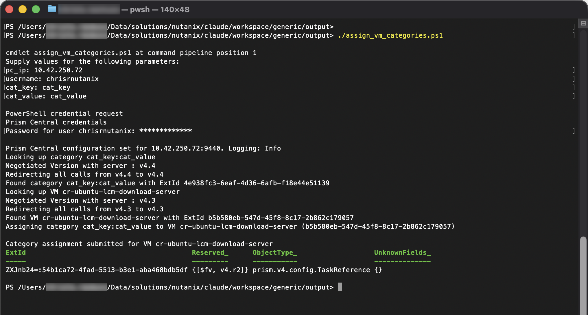

# Assign a Category to a VM with the Nutanix v4 PowerShell Cmdlets

`assign_vm_categories.ps1` looks up a category by key and value, looks up a VM by name, then assigns the category to that VM.

## Requirements

- PowerShell 7 or later
- The `Nutanix.Prism` and `Nutanix.Vmm` modules (version 1.0.0 or later)
- A Prism Central account with permission to list categories, list VMs and update VMs

```powershell
Install-Module -Name Nutanix.Prism,Nutanix.Vmm -Scope CurrentUser
```

## Before Running

- Edit `$VmName` in the script to the name of an existing VM. The VM name must be unique in Prism Central.
- The category passed with `-cat_key` and `-cat_value` must already exist in Prism Central.

## Usage

```powershell
./assign_vm_categories.ps1 -pc_ip <pc_ip_or_fqdn> -username <username> -cat_key <category_key> -cat_value <category_value> [-SkipCertificateCheck]
```

The script prompts for the Prism Central password, so no password is stored in the script.

TLS certificates are validated by default. `-SkipCertificateCheck` disables that validation for Prism Central instances with self-signed certificates; use it only in a test environment, as it may expose the connection to an unverified endpoint.

## Screenshot


